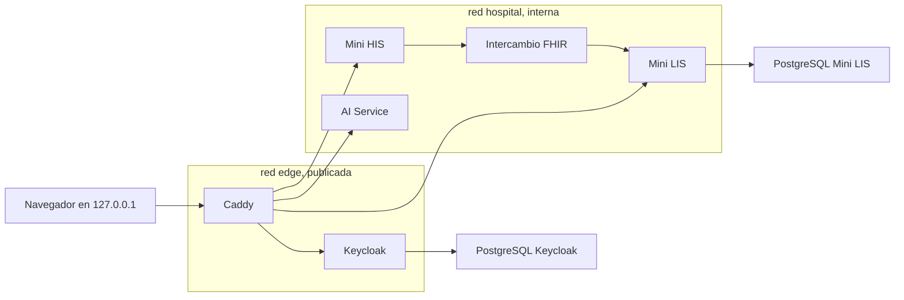

# HEALTHCARE-DEPLOY-001

Paquete privado y reproducible para una VM Ubuntu. Esta ejecución se hizo en Windows con Docker Desktop. No hubo VM Ubuntu ni distribución WSL aparte de `docker-desktop`. Eso deja la validación de VM en **BLOCKED**. No es una certificación clínica ni una exposición pública.

## Arquitectura



Perú y España no comparten esta red. Siguen en `infra/demo-deploy-001`, con redes y volúmenes propios. NeutralModelGateway no es un contenedor: corre dentro del AI Service. HAPI local no entra en este paquete.

## Matriz de servicios

| Servicio | Imagen | Puerto interno | Datos | Publicado |
|---|---|---|---|---|
| Caddy 2.10.2 | `caddy:2.10.2-alpine` | 18443, 18445, 18444, 18490 | volumen de la CA | `127.0.0.1` |
| Keycloak 26.8.1 | imagen fijada por digest | 8080 | PostgreSQL | no |
| PostgreSQL Keycloak | `postgres:16.10-alpine` | 5432 | volumen | no |
| Mini HIS | Java 21, Temurin, jar existente | 8095 HTTP, SQLite | volumen | no |
| Mini LIS | Java 21, Temurin, jar existente | 8096 HTTP, 2575 MLLP | PostgreSQL | no |
| Intercambio FHIR | Java 21, Dockerfile existente | 8081 HTTP, 2576 MLLP | SQLite | no |
| AI Service | Python 3.13 | 8090 | SQLite de ledger y revisión | no |
| PostgreSQL Mini LIS | `postgres:16.10-alpine` | 5432 | volumen | no |

El proxy de emisor es `socat` en Alpine, unido al espacio de red de Mini HIS o Mini LIS. Escucha `127.0.0.1:18443` y entrega el flujo a Caddy. El emisor del token y la URL que valida el servicio son la misma.

Variables de modelo: `CRITICAL_LAB_MODEL_MODE=intercepted` y `DISCHARGE_MODEL_MODE=intercepted`. El entrypoint del AI Service retira `GEMINI_API_KEY` y `OPENAI_API_KEY` si aparecen en el entorno.

## Perfiles

`hospital` y `showcase` arrancan el mismo conjunto. `maintenance` arranca solo las dos bases. `longitudinal` no crea contenedores en este archivo.

No hace falta tener los cinco recorridos encendidos a la vez. El escenario de 4 vCPU y 8 GiB es una hipótesis de planificación, no una capacidad medida de una VM.

## Secretos

`scripts/prepare.sh` escribe archivos de modo `0600` en `run/secrets/`. Compose los monta como secrets. `env.example` solo tiene marcadores. El realm generado sustituye `REPLACE_AT_IMPORT` y los puertos `8445`/`8444` por `18445`/`18444`. No se imprime el valor.

## HTTPS y OIDC

Caddy usa `tls internal`. La consola de administración de Keycloak no está enrutada: cualquier ruta distinta de `/realms/` y `/resources/` responde 404. Las cookies de Mini HIS y Mini LIS piden `Secure`.

La raíz de Caddy se copia a `run/caddy-root.crt` después del primer arranque. Java la importa en un almacén temporal del contenedor. El AI Service la usa como `SSL_CERT_FILE`. No se ejecuta `caddy trust` ni se toca el almacén de Windows.

## Firewall del host

Estas reglas son documentación. No se aplicaron en esta máquina.

```sh
ufw default deny incoming
ufw allow OpenSSH
ufw deny 5432
ufw deny 2575
ufw deny 2576
ufw deny 8081
ufw deny 8090
ufw deny 8095
ufw deny 8096
```

Los puertos HTTPS de Caddy quedan en loopback y no necesitan apertura hacia la red. No cerrar el acceso administrativo SSH de una máquina compartida.

## Persistencia

| Dato | Tratamiento |
|---|---|
| PostgreSQL de Keycloak y Mini LIS | volumen nombrado, imprescindible |
| SQLite de Mini HIS, intercambio y ledger | volumen nombrado, imprescindible |
| Realm y bindings | generados o copiados en `run/`, regenerables desde el repositorio salvo la contraseña |
| Secretos | `run/secrets/`, fuera de Git |
| CA de Caddy | volumen `caddy-data`, regenerable; los clientes deben volver a confiar la raíz nueva |

`scripts/stop.sh` no borra volúmenes. No se usa `docker compose down -v`.

## Respaldo y restauración

`scripts/backup.sh` ejecuta `pg_dump` dentro del contenedor de cada PostgreSQL y la API `Connection.backup` de SQLite sobre el volumen, no una copia del archivo activo. El manifiesto guarda identificador, fecha, tamaño y SHA-256. El permiso de archivo no es cifrado: este paquete no cifra los respaldos.

`scripts/restore-test.sh` hace la restauración en un proyecto Docker distinto. Inserta `case-deploy-001` / `synthetic-order-kept`, restaura en otro volumen y comprueba la fila. Al terminar retira solo esos contenedores, volúmenes y la red del ensayo.

## Rollback

1. Anotar la etiqueta de imagen anterior y la nueva.
2. Ejecutar `backup.sh` y conservar el directorio.
3. Si la migración Flyway ya se aplicó, no hay sentencia inversa en este paquete.
4. Restaurar el volcado en un volumen nuevo, como hace el ensayo.
5. Volver a la etiqueta de imagen anterior solo después de comprobar el marcador.
6. Repetir `health.sh`.

Reconstruir la etiqueta `0.1.0` no deshace una migración.

## Observabilidad

Cada servicio tiene healthcheck. Los logs usan el controlador `json-file`, con rotación de 10 MiB y tres archivos. No se añade Prometheus ni Grafana. Los healthchecks no devuelven historias clínicas ni tokens. `scripts/health.sh` imprime estado y salud.

## Rendimiento

La medición de esta sesión es la del ensayo de restauración y la memoria que Docker Desktop reporta, no un servidor de 8 GiB. Los cinco escenarios simultáneos no se arrancaron. El perfil hospitalario y el longitudinal se operan por separado antes de pedir un servidor mayor.

## Guion de las cinco demostraciones

Con el perfil `hospital` sano, en el navegador de prueba que ya confía la raíz de Caddy:

1. DEMO-001: `https://127.0.0.1:18445`, ingreso OIDC, paciente nuevo, resumen, revisión humana y auditoría.
2. DEMO-002: parar el perfil hospitalario si la memoria no alcanza y arrancar `infra/demo-deploy-001` para Perú y después España.
3. DEMO-003: orden en Mini HIS, entrega HL7 a Mini LIS y resultado FHIR.
4. DEMO-004: resultado crítico, agente con modelo interceptado, aprobación y tarea reconocida.
5. DEMO-005: episodio nuevo, alta preparada y una sola tarea de seguimiento.

Un caso nuevo obtiene un permiso nuevo. Esta sesión no ejecutó esos recorridos.

## Resultados de esta ejecución

Entorno: Windows, Docker Desktop, motor `linux` 29.4.0, 4 CPU y 5.788 GiB visibles para Docker. WSL solo tiene la distribución `docker-desktop`. No se instaló Ubuntu ni se modificó el firewall o el almacén de certificados.

| Área | Resultado |
|---|---|
| Linux VM Ubuntu | BLOCKED |
| WSL Ubuntu | BLOCKED. No está instalada |
| Motor de contenedores | Linux, sobre Docker Desktop. No es una VM Ubuntu |
| Build del proxy de emisor | PASS. Imagen `healthcare-deploy-loopback-proxy:0.1.0` desde Alpine 3.22.1 |
| Builds de Mini HIS, Mini LIS, intercambio y AI | No ejecutados |
| Compose y puertos loopback | PASS. `scripts/verify.sh` |
| Red interna de prueba | PASS. El contenedor de la red alcanzó a su vecino y no abrió `1.1.1.1:443` |
| OIDC, HTTPS de navegador y DEMO-001 a DEMO-005 | BLOCKED. El perfil hospitalario no se arrancó |
| Backup del ensayo | PASS. 1218 bytes, SHA-256 `4642ccbfb07269f187927890318e13844a8470e62f2db896cdbf75dd22a8239d` |
| Restauración aislada | PASS. 15 segundos. Marcador `synthetic-order-kept` en PostgreSQL y en la copia SQLite |
| Rollback | PASS del ensayo sobre un volumen nuevo. No se revirtió una migración Flyway en un volumen en uso |
| Muestra de recursos | El PostgreSQL restaurado ocupaba 33.84 MiB y 0.04 % de CPU en el instante posterior. No es la carga de una demostración |
| Egress de los servicios clínicos | No observado |
| Cifrado de respaldos | No. Solo quedan fuera de Git |

El estado de la entrega es **PARTIAL**. Falta una VM Ubuntu, la construcción de las imágenes de aplicación, el arranque del perfil y los cinco recorridos.

