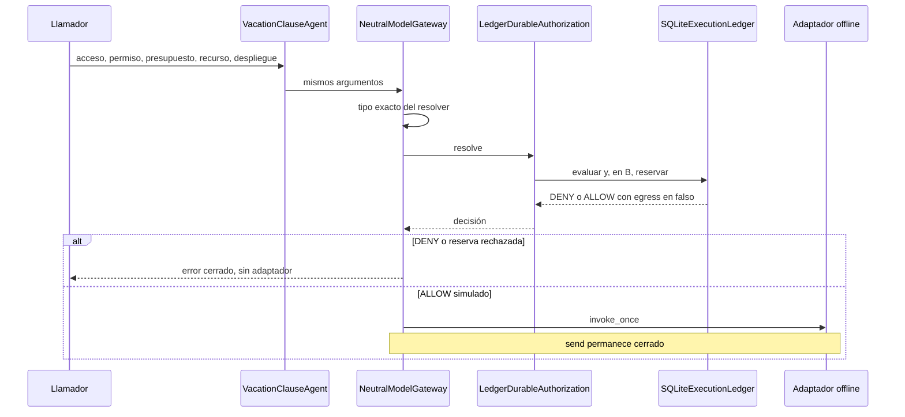

# TASK-C04-D04 — Política confiable y enforcement previo al egress

Estado: **propuesta**. No está aprobada. No autoriza implementación, commit, migración, egress, `live-once` ni una llamada real.

Repositorio de referencia: Healthcare AI & Interoperability Lab. Esta propuesta no describe otro producto.

Base comprobada en `origin/main`: merge del PR #130, `ab5a4f02aacb7e19cd804f7615b69d90e137dfee`. El commit funcional de D03 es `47ea75399256e06a0b2cb089052913257b17971c`. `main` local puede estar detrás y esta propuesta no lo actualiza.

Conflictos resueltos a favor del repositorio:

- C03 permanece protegido por `type(self.model) is FakeEnterpriseModel` en `enterprise_ai_processing/gateway.py`. `OfflineModelHarness` es la simulación del gateway neutral y del dry-run de Gemini. No es el control de C03.
- El roadmap conserva TASK-C04 como evaluación de proveedor real todavía no autorizada. D04 no es esa evaluación.
- El `RemoteExecutionPermit` en memoria de Phase A no es la autoridad operativa. La autoridad vigente es `aip_remote_execution_permit`.
- No existe una definición previa de D04. Los tres incrementos de abajo son propuesta, no decisión aprobada.

## Garantías vigentes

| Garantía | Estado |
|---|---|
| `NeutralModelGateway.execute` exige `type(resolver) is LedgerDurableAuthorization` | Implementada |
| Ese resolver solo se construye con `type(ledger) is SQLiteExecutionLedger` | Implementada |
| Resolver falsificado, subclase y `FakeLedger` niegan sin ejecutar `resolve` o sin construirse | Implementada y probada |
| Organización, despliegue, proveedor, modelo, operación, capacidad, vigencia, revocación y política salen de la fila o del catálogo | Implementada |
| Identidad de laboratorio por identidad de objeto; una copia o un `ExecutionGrant` no están reconocidos | Implementada |
| `VacationClauseAgent` solo acepta `NeutralModelGateway` | Implementada |
| V1 y V2 no se migran al evaluar; un fallo de auditoría de ALLOW no publica `accepted` | Implementada |
| `egress_allowed`, `live_authorized` y `c03_connected` permanecen en falso | Implementada |
| `OpenAISDKTransport.send` y `GeminiSDKTransport.send` lanzan `egress_blocked` | Implementada |
| C03 sigue en `FakeEnterpriseModel` | Implementada |
| Presupuesto y recurso del llamador no elevan la reserva del catálogo | Parcial: el número alto no cambia la reserva, pero no está guardado en el permiso |
| Replay entre dos instancias del gateway | Parcial: `_spent` vive en la instancia; otro gateway vuelve a leer la fila `active` |
| Revalidación en la misma transacción que abriría el transporte | Propuesta. El transporte no existe |
| Principal, recurso y techo de presupuesto dentro de la fila | Propuesta |
| IAM empresarial, lease distribuido y egress | Fuera de alcance. No se proponen como implementación |

El reemplazo de métodos dentro del mismo proceso queda fuera de la identidad sintética. D04 no lo cubre con un token ni con IAM improvisado.

## Atributos

| Atributo | Fuente confiable hoy | Dato que el llamador puede declarar | Propuesta D04 |
|---|---|---|---|
| Organización | `LaboratoryAccess` reconocido | No es argumento aparte | Seguir exigiendo el acceso reconocido |
| Principal | El mismo acceso | No es argumento aparte | Guardarlo en la fila y compararlo |
| Recurso | Ninguna fila | `resource_id`; solo se rechaza la cadena vacía | Guardarlo y exigir igualdad exacta |
| Despliegue, proveedor y modelo | Catálogo cerrado y fila | El llamador elige un `deployment_id` del catálogo | Mantener el catálogo; la fila manda |
| Operación y capacidad | Constantes `vacation-days-v1` y `structured_output+usage_report` | Una operación distinta se niega antes del bridge | Conservar el catálogo cerrado |
| Presupuesto | Reserva fija del despliegue | `budget_microusd` | Techo durable. Un número mayor se niega. La reserva cobrada sigue siendo la del catálogo |
| Vigencia y revocación | Fila V3 | Ninguno | Releerlas en la misma transacción de reserva |
| Política | `model-gateway-policy-v1`, versión 1 | Ninguno | Conservar el CHECK |
| Correlación | `event_id` de auditoría generado por el ledger | No hay argumento de correlación | El llamador no aporta ese identificador |
| Egress | Decisión forzada a falso | `supplied_url` ya se rechaza | Sigue en falso |

Ejemplo sintético: organización `ORG-A`, principal del acceso de laboratorio, recurso `vacation-a`, despliegue `openai-offline-a`, proveedor `openai`, modelo `gpt-6-luna`, techo `1000` micro-USD. La reserva del catálogo offline de OpenAI permanece por debajo de ese techo. Un presupuesto de `10000000` no eleva la reserva y, con el techo durable, deja de ser aceptable.

## SPECIFY

### Problema

D03 impide que un `ExecutionGrant` fabricado autorice el gateway operativo. La fila durable todavía no fija el principal, el recurso ni el techo de presupuesto. La marca de replay es memoria de una instancia. Entre la evaluación y una invocación futura queda la ventana ya documentada.

### Objetivo

Definir, sin implementar todavía, cómo el ledger pasa a ser la autoridad de esos tres atributos y cómo una sola transacción SQLite del proceso reserva el uso antes de la simulación. El transporte real permanece cerrado.

### Alcance

- D04-A: vínculo durable de principal, recurso y techo de presupuesto.
- D04-B: reserva de un solo uso en el mismo archivo SQLite, revalidada en la transacción.
- D04-C: puntos de extensión escritos en esta propuesta. La única implementación autorizable después es un control que sigue devolviendo `egress_blocked`.

### Exclusiones

No se autoriza egress, `live-once`, apertura de `send`, conexión de C03, cambio de `FakeEnterpriseModel`, IAM de producción, Keycloak en este camino, lease distribuido, PostgreSQL, RAG, MCP, Gate D, datos reales, credenciales, migración automática, reutilización del 003 clínico, ni reescritura del permiso en memoria de Phase A. El harness offline conserva su contrato de simulación y no se convierte en ruta operativa.

### Actores y límites

- Administrador sintético: registra y revoca dentro de su organización. No hay ruta HTTP.
- Ejecutor sintético: evalúa. Su principal tiene que coincidir con la fila propuesta.
- Gateway operativo: no abre SQLite. Recibe la decisión del resolver exacto.
- Ledger: autoridad de existencia, alcance, vigencia, revocación y, en esta propuesta, principal, recurso, techo y reserva.
- Catálogo: autoridad de proveedor, modelo, capacidad y reserva de planificación.
- Harness y dry-run: laboratorio. No consumen la reserva operativa.
- Transporte: no es un componente confiable todavía. Hasta que exista, ninguna reserva abre `send`.

### Requisitos

1. Un parámetro del llamador no amplía organización, principal, recurso, despliegue, proveedor, modelo, operación, capacidad, techo ni reserva.
2. La comparación de principal, recurso y techo ocurre dentro de `evaluate_remote_authorization`, no solo en el gateway.
3. Un techo inferior a la reserva del catálogo es `invalid_input` en el alta y no queda activo.
4. Un presupuesto del llamador mayor que el techo almacenado se niega. La reserva registrada sigue siendo `deployment.reservation_microusd`.
5. Un recurso distinto o vacío se niega y no llama al adaptador.
6. Abrir el almacén no migra. `migrate_to_v4` y `migrate_to_v5` son operaciones explícitas.
7. V4 no inventa principal, recurso ni techo para filas V3. Si existe alguna fila en `aip_remote_execution_permit`, la migración falla cerrada.
8. La auditoría de un ALLOW que no se confirma revierte la transacción.
9. D04-B inserta la reserva y revalida la fila en el mismo `BEGIN IMMEDIATE`.
10. Una segunda reserva del mismo permiso, incluso desde otro objeto gateway, se niega.
11. Una revocación o una expiración observada en esa transacción impide la reserva.
12. `RemoteAuthorizationDecision` mantiene `egress_allowed`, `live_authorized` y `c03_connected` en falso.
13. Un fallo de almacenamiento no se convierte en ALLOW.
14. Los registros siguen sin prompts, extractos, respuestas de proveedor, credenciales ni datos clínicos. El ejemplo sintético `VACACIONES: 20 dias tras 12 meses de servicio.` no entra en la auditoría.

### Invariantes

- Deny por defecto.
- El tipo exacto del resolver y del ledger se conserva.
- El catálogo de cuatro triples y la operación `vacation-days-v1` se conservan.
- Una fila `active` no abre egress.
- C03 no importa `model_gateway`.
- El harness no importa el ledger para autorizarse.

### Flujos

Aceptación propuesta, todavía simulada: acceso reconocido, fila V4 vigente, principal y recurso iguales, presupuesto del llamador entre la reserva del catálogo y el techo, operación fija, auditoría confirmada y, en B, una reserva nueva. El adaptador offline puede invocarse. `send` no.

Rechazo: cualquiera de los atributos no coincide, el permiso está revocado o vencido, el almacén es V1–V3, la migración no fue explícita, la auditoría falla, ya hay una reserva, o el resolver no es la clase exacta. El adaptador queda en cero llamadas.

### Criterios medibles

- Un presupuesto `10000000` contra un techo `1000` produce denegación y `calls == 0`.
- Un recurso distinto de `vacation-a` produce denegación y `calls == 0`.
- Un principal distinto del almacenado produce denegación.
- Dos gateways nuevos sobre el mismo permiso: la segunda reserva se niega.
- Una revocación entre la primera lectura y la transacción de reserva se niega.
- V3 con filas no migra a V4.
- `schema_version` no cambia al evaluar.
- Ambos `send` siguen en `egress_blocked`.
- La regresión D03, 218/37/34/74/405, se repite sin solicitudes reales. El conteo puede subir solo por pruebas nuevas de A o B.

### Decisiones registradas

El Product Owner fijó estas decisiones para el contrato. A1 no implementa A2 ni B.

- Una discrepancia de principal o de recurso usará `scope_mismatch`. Ese motivo ya está en el CHECK de auditoría. A1 no compara esos campos. A2 los compara dentro del ledger, con el principal del acceso reconocido.
- Un exceso sobre el techo almacenado usará `budget_exceeded`. A1 no lo escribe. El CHECK publicado de `enterprise-remote-authorization-audit-v1` no se reescribe. A2 lo habilita solo en filas nuevas del contrato `enterprise-remote-authorization-audit-v2`. Un techo que no es un entero, o que queda fuera de la reserva del catálogo y del tope de laboratorio de 5.000.000 micro-USD, sigue siendo `invalid_input` en el alta.
- El objetivo de D04-B es un permiso operativo de un solo uso. A1 no crea la reserva.
- Una reserva `held` con resultado incierto no se libera sola. Esa recuperación administrativa sigue sin implementarse.
- La atomicidad del ledger no es una entrega exactamente una vez a un proveedor externo. No hay transporte en esta tarea.

### Auditoría de A2

`budget_exceeded` no cabe en el CHECK publicado por la migración 004. Esa migración no se reescribe y su checksum no cambia. La versión 5 sigue reservada para la reserva de D04-B. La evolución es `migrate_remote_audit_v2`: una transacción explícita que copia las filas de `aip_remote_authorization_audit` sin cambiar su contrato ni su motivo, y admite filas nuevas con `enterprise-remote-authorization-audit-v2` y el motivo `budget_exceeded`. El `schema_version` permanece en 4. Si la copia no se confirma, el archivo sigue en el esquema V4 anterior. La ruta operativa del gateway exige ese vocabulario. Un almacén V3, o un V4 sin esta migración, responde `authority_unverifiable` y no disfraza el rechazo de un fallo de disco.

### Ajuste de SQLite en A1

`ALTER TABLE ADD COLUMN` no admite una columna `NOT NULL` sin valor por defecto. Un defecto inventaría principal, recurso y techo para las filas V3. V4 no usa `ADD COLUMN`. Dentro de una transacción comprueba que `aip_remote_execution_permit` está vacía y reconstruye la tabla. Si hay filas, la migración lanza `revision_conflict` antes de cambiar el esquema. El `INSERT` de la reconstrucción también falla si apareciera una fila, y el rollback deja el archivo en V3. Abrir el almacén no llama a `migrate_to_v4`. El índice activo pasa a incluir principal y recurso. La auditoría V3 se copia y conserva su contrato.

## PLAN

### Componentes

- `remote_authorization.py`: campos nuevos del registro y comparación en `classify`.
- `migrations/004_remote_authorization_binding.sql`: versión 4, aditiva, sin filas iniciales.
- `migrations/005_remote_execution_reservation.sql`: versión 5, solo si B se aprueba.
- `sqlite_ledger.py`: `migrate_to_v4`, `migrate_to_v5`, alta, evaluación y reserva en `BEGIN IMMEDIATE`.
- `durable_resolver.py`: pasa principal, recurso y presupuesto observados. No acepta otro ledger.
- `gateway.py`: deja de tratar el recurso y el presupuesto como autoridad. Sigue sin importar el harness y sin abrir SQLite.
- `agent.py`: conserva la firma operativa y el tipo exacto del gateway.
- Inventario de arquitectura: solo los módulos e imports nuevos que una tarea aprobada añada.
- `OfflineModelHarness`, `gemini_live.py`, C03 y los dos `send`: sin cambio de autoridad.

### Persistencia propuesta

V4 añade a una tabla reconstruida, al estilo de la migración 003, las columnas `principal_id`, `resource_id` y `budget_ceiling_microusd`. El índice único activo pasa a incluir principal y recurso. No hay comodines. La reversión es restaurar la copia del archivo tomada antes de migrar. No hay migración hacia abajo ni `DROP` de una base existente como procedimiento de la petición.

V4 falla si `aip_remote_execution_permit` tiene filas. Un laboratorio vuelve a registrar el permiso con los tres atributos. No se rellenan por inferencia.

V5, separada, añade `aip_remote_execution_reservation`: identificador de reserva, `authorization_id`, organización, estado `held` o `consumed`, marcas de tiempo y un índice que impide dos `held` del mismo permiso. La inserción y la relectura de vigencia, revocación, principal, recurso y techo comparten la transacción. El estado del permiso no gana un valor nuevo en esta propuesta.

SQLite sigue siendo un archivo, un proceso y Windows. `BEGIN IMMEDIATE` serializa escritores de ese archivo. No se propone otro motor. Un lease distribuido solo tendría sentido con varias réplicas y un transporte que esta fase no crea.

### Presupuesto y concurrencia

El techo almacenado limita lo que el llamador puede presentar. La cifra que se reserva para la simulación sigue siendo la del catálogo. Un fallo del adaptador después de `held` no publica ALLOW y no abre `send`. El paso de `held` a un cierre terminal queda en la misma tarea B, con prueba de que un error no deja un segundo uso. Si el proceso muere en `held`, la siguiente ejecución sigue negada hasta una recuperación administrativa explícita. Esa recuperación no forma parte del primer incremento.

La ventana que D04-B puede cerrar es la que existe dentro de este proceso, entre leer la fila y simular el adaptador. La ventana entre esa simulación y un `send` futuro permanece abierta hasta que el transporte confiable entre en la misma transacción. Ese transporte no se diseña como código ejecutable aquí.

### Compatibilidad y errores

D03 sigue siendo el comportamiento de un almacén V3. El gateway operativo, después de A2, exige V4 y niega V3 con `authority_unverifiable`, igual que hoy niega V2. El harness no participa. Cualquier excepción de almacenamiento es denegación. Una decisión `allowed is True` solo existe con motivo `accepted` y con los tres flags de egress en falso.

### Riesgo de migración

Reconstruir `aip_store` y la tabla del permiso puede dejar el archivo a medias si se interrumpe. El procedimiento propuesto es el mismo de V3: copia previa y restauración. No se migra durante una solicitud. El 003 clínico `003_follow_up_human_attribution.sql` no se toca.

### Secuencia

A1 migra y registra el contrato. A2 hace que el gateway niegue recurso y techo. A3 repite la regresión y confirma que el harness, C03 y `send` no cambiaron. B1 añade la reserva. B2 prueba concurrencia y revocación dentro de la transacción. C1 es solo evidencia de que no apareció un camino de egress. C no empieza antes de que A esté verde. B no empieza antes de A2.

## TASKS

### TASK-C04-D04-A1 — Contrato y migración explícita

Propósito: guardar principal, recurso y techo sin cambiar el gateway.

Dependencias: PR #130 en `origin/main`. Ninguna otra tarea D04.

Componentes: `remote_authorization.py`, migración 004, `sqlite_ledger.py`, pruebas del ledger.

Contrato: alta solo con los tres campos; techo menor que la reserva del despliegue es `invalid_input`; V4 no arranca si ya hay permisos; abrir el archivo no migra.

Aceptación: una fila sintética `ORG-A` / `vacation-a` / techo `1000` se registra y se evalúa; una fila V3 bloquea la migración; `egress_allowed` sigue en falso.

Pruebas: unitarias de `classify`, integración SQLite en directorio temporal, negativa de migración con filas y de almacén V3.

Evidencia: esquema 4 solo después de `migrate_to_v4`; cero sockets.

Riesgo: reconstruir tablas. Regresión del ledger D02 y de la arquitectura. Rollback por copia del archivo.

### TASK-C04-D04-A2 — El gateway deja de confiar en recurso y presupuesto

Propósito: cerrar la ampliación por parámetros del llamador.

Dependencias: A1.

Componentes: `durable_resolver.py`, `gateway.py`, `agent.py`, prueba durable.

Contrato: el resolver compara principal, recurso y techo dentro del ledger. El gateway conserva el tipo exacto y construye el grant interno solo después del ALLOW.

Aceptación: recurso distinto, principal distinto y presupuesto `10000000` niegan con `calls == 0`. La reserva del resultado aceptado sigue siendo la del catálogo. Una subclase y un `FakeLedger` siguen negando.

Pruebas: negativas de seguridad más el camino sintético aceptado. Sin `send`.

Evidencia: aserciones de `calls == 0` y de reserva distinta de `10000000`.

Riesgo: cambiar la firma interna de `resolve`. Regresión de gateway, SDK y D03.

### TASK-C04-D04-A3 — Aislamiento

Propósito: demostrar que A2 no abre otra ruta.

Dependencias: A2.

Componentes: inventario, pruebas de arquitectura, C03, transportes y harness. Sin cambio de comportamiento esperado.

Contrato: el gateway no importa el harness; el agente rechaza el harness; C03 sigue en el fake.

Aceptación: la regresión 218/37/34/74/405, más las pruebas nuevas, queda en verde. Ambos `send` lanzan `egress_blocked`.

Evidencia: conteos y ausencia de solicitudes reales.

### Verificación A3 incorporada al PR de A2

A3 no añade comportamiento. La evidencia ejecutada en este cierre es 242 PASS: C03, el inventario de arquitectura, el gateway durable, A1, A2, los SDK, los dos `send` y las pruebas de `live-once` que permanecen bloqueadas, con sockets sustituidos y datos sintéticos. La batería amplia de 1374 PASS y 1 SKIP, corrida sobre el mismo árbol antes de esta nota, se reutiliza para C01, C02, conectores y el resto de D03. El SKIP es el enlace simbólico sintético que el sistema operativo no permite crear. B y C1 siguen fuera de este cambio.

Riesgo: un import nuevo rompe el inventario. Corregir solo el allowlist de lo que A2 haya añadido.

### TASK-C04-D04-B1 — Reserva en el mismo proceso

Propósito: un permiso operativo no se reutiliza por crear otro gateway.

Dependencias: A2. Requiere aprobación propia. No forma parte del primer incremento.

Componentes: migración 005 y métodos de reserva del ledger.

Contrato: una transacción revalida y deja una sola fila `held`. La segunda es `replay_denied` o el motivo cerrado que se apruebe. El harness no reserva.

Aceptación: dos instancias del gateway; solo la primera simula. Un almacén V4 sin migrar a V5 niega la ruta que exige reserva.

Pruebas: integración y negativa de replay. Sin red.

Evidencia: una fila `held` y `calls == 0` en el segundo intento.

Riesgo: cambiar el permiso D03 de evaluación repetible a un solo uso operativo. El documento de publicación tiene que decirlo. Rollback por copia del archivo.

### TASK-C04-D04-B2 — Carrera, revocación y fallo

Propósito: la reserva no sobrevive a una revocación ni a un fallo de auditoría.

Dependencias: B1.

Componentes: ledger y pruebas concurrentes en un archivo temporal.

Contrato: `BEGIN IMMEDIATE`; revocación o expiración dentro de la transacción impide `held`; un fallo al auditar revierte la reserva; dos escritores del mismo archivo no crean dos `held`.

Aceptación: pruebas que fallen si la segunda transacción observa un ALLOW ya revocado.

Evidencia: cero filas `held` cuando la auditoría falla.

Riesgo: SQLite no representa varias réplicas. La prueba no debe presentarse como lease distribuido.

### TASK-C04-D04-C1 — Evidencia de egress cerrado

Propósito: dejar escrito el punto futuro y comprobar que no quedó un camino activo.

Dependencias: A3. No depende de B para ejecutarse, y no implementa IAM ni transporte.

Componentes: esta propuesta y una prueba negativa de los módulos ya existentes.

Contrato futuro, no implementado: un `PreEgressGate` confiable tendría que repetir la reserva en la misma decisión que abriera `send`. La única conducta autorizable ahora es seguir lanzando `egress_blocked`. No se añade una clase activable por configuración.

Aceptación: no aparece `egress_allowed = True` en la decisión durable; C03 no importa el gateway neutral; no hay cliente HTTP nuevo.

Evidencia: prueba de fuente y de los dos `send`.

Riesgo: crear una interfaz “apagada” que alguien active después. Por eso C1 no añade esa clase.

## Amenazas

| Riesgo | Control propuesto | Conducta | Prueba |
|---|---|---|---|
| El llamador amplía permisos | Fila y catálogo, no el argumento | Denegación | Presupuesto `10000000`, otra capacidad, otro modelo |
| Confusión de organización | Acceso reconocido y organización de la fila | `not_granted` | Ejecutor de `ORG-B` |
| Otro modelo | Triple cerrado | `invalid_input` o `wrong_model` | `gpt-6-sol` |
| Presupuesto manipulado | Techo durable y reserva de catálogo | Denegación; la reserva no sube | A2 |
| Grant reutilizado | Tipo exacto del resolver; B añade un solo uso | `remote_not_authorized` o `replay_denied` | Grant fabricado y segundo gateway |
| Revocación durante la ejecución | Relectura en la transacción de B; hoy, la evaluación siguiente | `revoked` | Revocar entre dos evaluaciones y, en B, dentro de la reserva |
| Carrera | `BEGIN IMMEDIATE` y un `held` | Una sola reserva | Dos escritores |
| Resolver sustituido | Clases exactas | `remote_not_authorized` | `ForgedKind`, subclase, `FakeLedger` |
| Ledger, política y gateway divergentes | El gateway no acepta un ALLOW cuyo despliegue no coincide | `remote_not_authorized` | Decisión alterada en una prueba de contrato |
| Datos sensibles | Auditoría de identificadores y motivos cerrados | El texto sintético no aparece | Búsqueda de `VACACIONES`, `sk-` y `AIza` |
| Fallo abierto | Excepción de disco o auditoría incompleta | `storage_unavailable`, sin `accepted` | Fallo inyectado antes del commit |
| Egress accidental | Flags forzados y `send` cerrado | `egress_blocked` | C1 |

## Primer incremento

Cuando el Product Owner autorice implementación, el primer corte es **TASK-C04-D04-A1**. Es reversible por copia del archivo, no cambia el gateway y no abre egress.

A1, A2 y A3 están en `main` mediante los PR #131 y #132. D04-B y la nota C1 están en `feature/enterprise-ai-processing-task-c04-d04-b`. El transporte real sigue cerrado.

### D04-B — Reserva de un solo uso

`migrate_to_v5` es explícita. Exige el DDL de V4 con auditoría v2, copia todas las columnas de la auditoría y deja `schema_version` en 5. La migración 004 y el script de auditoría v2 no cambian. Abrir el almacén no migra. La tabla `aip_remote_execution_reservation` admite una fila por `authorization_id`, en estado `held` o `consumed`, con clave foránea al permiso. El índice parcial impide dos filas `held`. La clave única impide además una segunda fila después de `consumed`.

La ruta operativa del gateway exige esa versión. Un V4 auditado, sin V5, responde `authority_unverifiable`. En una transacción `BEGIN IMMEDIATE` el ledger revalida vigencia, revocación, principal, recurso, presupuesto, organización y alcance; inserta `held`; escribe la auditoría y confirma el commit antes de construir el grant. La segunda solicitud de un permiso vigente recibe `replay_denied`. Si el permiso fue revocado o venció, la revalidación responde `revoked` o `authorization_expired` y no crea otra reserva. Un fallo antes del commit no deja fila. Un fallo del adaptador, o un fallo al marcar `consumed`, deja `held`.

### Reconciliación

No hay liberación automática ni reintento ciego. Si el proceso cae con una fila `held`, la siguiente ejecución sigue denegada y la auditoría del ALLOW confirmado permanece. El procedimiento de laboratorio es copiar el archivo SQLite, inspeccionar esa fila y su auditoría, y no borrarla desde la ruta operativa. Una liberación administrativa sería otra tarea. La fila local no demuestra que un proveedor externo haya ejecutado la llamada una sola vez.

### D04-C1 — Punto previo al egress

C1 no añade clases, interruptores ni conectividad. Un transporte futuro tendría que repetir la reserva vigente en la misma decisión que abriera `send`. Hoy ambos `send` lanzan `egress_blocked`, `live-once` sigue bloqueado y C03 sigue en `FakeEnterpriseModel`.

SQLite garantiza, para este archivo y un proceso en Windows, la serialización de escritores, una sola reserva confirmada por permiso y la auditoría en la misma transacción. El bloqueo del archivo protege ese despliegue y no constituye una garantía entre réplicas distribuidas. No garantiza una llamada HTTP exactamente una vez, ni el orden entre la simulación local y un proveedor, ni la recuperación de un `held` incierto, ni un lease entre réplicas.

Siguen pendientes el IAM de producción, la atribución distinta del administrador sintético y la autorización expresa para un proveedor real. Esa autorización exigiría un gate previo al egress, credenciales fuera del repositorio y una reconciliación que no reintente a ciegas una reserva `held`.

### EGRESS-001 — Controlled Real OpenAI Execution

El siguiente incremento planificado, todavía sin implementar, es una primera llamada HTTPS real desde `NeutralModelGateway` a OpenAI. Usaría datos sintéticos, credenciales fuera del repositorio, la reserva durable de D04-B y una autorización expresa del Product Owner. Esta nota no modifica `send`, no activa `live-once` y no realiza ninguna solicitud externa.
