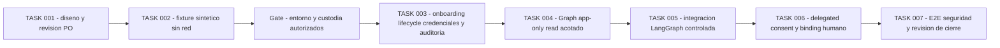

# Enterprise Connector Authorization V1 — propuesta de implementación

TASK 001 es solo diseño. El Product Owner aprobó la dirección arquitectónica y [ADR-097](../adr/ADR-097-enterprise-connector-authorization-boundaries.md), **Accepted — architectural direction only**. [Arquitectura](enterprise-connector-authorization-v1.md), [contrato](../contracts/enterprise-connector-authorization-v1.md), [perfil Graph](../contracts/microsoft-graph-connector-permissions-v1.md) y [threat model](enterprise-connector-threat-model-v1.md) describen controles pendientes de implementación. Todas las tareas posteriores son **propuestas no autorizadas**. No provisionar Azure/Entra, obtener consentimiento, pedir secretos ni llamar a Graph con este plan.

## Secuencia recomendada y motivo del ajuste

Se proponen **siete tareas**, incluida TASK 001. Custodia/lifecycle/auditoría/onboarding controlado preceden al lector real. La integración controlada con LangGraph tiene una fase propia después del adaptador y antes de delegated; no se supone un framework empresarial genérico existente. Delegated conserva una fase independiente porque las sesiones actuales no implementan identidad humana corporativa. Cada incremento requiere autorización propia del Product Owner.

La aprobación de un diseño o PR no autoriza automáticamente el siguiente nodo. Si no existe tenant test-owned, administrador y custodia aprobados, detener los incrementos reales; continuar solo pruebas sintéticas dentro de su autorización, nunca recurrir a cuentas personales, contraseñas o scopes más amplios.

## TASK 001 — Architecture, Authorization Contracts & Threat Model

Salida: documentos coherentes, investigación oficial fechada, ADR aceptado solo como dirección arquitectónica, modelo local/externo separado y 24 amenazas trazadas. Validación: enlaces/terminología/diagramas/whitespace/ausencia de secretos e integridad Git. No código, tablas, migraciones, endpoints, infra ni credenciales. El Product Owner autoriza los ajustes finales y commit/push de los nueve documentos; el PR queda pendiente de revisión. El diseño no es enforcement ni prueba operacional Graph.

## TASK 002 — Synthetic Connector Authorization Fixture

Entorno determinista, sin SDK Graph operativo ni llamadas a Entra/Graph/cloud. Futuro fixture propio de definiciones/instancias/bindings/grants, contexto verificado simulado y broker/adaptador/auditoría como dobles. Nunca reutilizar un texto de PrincipalContext recibido del modelo como autoridad real. Modelar expiraciones y revisiones, exact/subtree, modo y namespaces por proveedor sin asumir storage de producción.

Casos mínimos de aceptación:

- Deny por principal/organización/tenant/app/modo/recurso/grant inválidos; cero llamadas al broker/adaptador antes de autorización y auditoría.
- Cross-org con mismos IDs, invitado/tenant hogar distinto, resource substitution/move/parent y scopes falsos; no grant union ni fallback.
- Retiro/restauración local, revisión vieja/replay y carrera en fetch/paginación/entrega; no presentar revocación instantánea externa.
- Sink previo/final no disponible, credencial ausente/caducada, 401/403/429/5xx, timeout y parcialidad; contadores prueban ausencia de efectos no autorizados.
- Prompt injection, URL/nextLink/redirect maliciosos, exfiltración, formato activo/oversize y solicitud de RAG/MCP no habilitado.
- Gates A/B/C/D del [contrato](../contracts/enterprise-connector-authorization-v1.md#autorizaciones-independientes-de-uso-de-datos): lectura permitida no permite modelo no autorizado; documento hostil no activa herramientas ni modifica permisos; cache hit se reautoriza antes de entregar; contenido/citas/resultados de B no aparecen en A; lectura no permite indexación, sharing ni exfiltración. Son pruebas futuras con dobles, no controles ejecutados en TASK 001.
- Fixture puramente sintético sin JWT/secretos reales, históricos/migraciones ni servicios ajenos; límites cuantitativos propuestos medidos y revisados.

Salida: pruebas deterministas etiquetadas, gaps y propuesta de perfiles. No PASS live ni solicitud de credenciales como atajo. Evidencia para T01–T24 según [modelo](enterprise-connector-threat-model-v1.md).

## TASK 003 — Controlled Onboarding, Credential Lifecycle & Audit

Requiere autorización nueva: responsable cliente/PO, tenant y recursos de prueba, clasificación sintética, modo app-only inicial, modelo single/multitenant y separación de identidades administrativas/lector. Decidir módulo/SDK, vault o mecanismo aprobado existente, custodia de certificado/federación/secretos y acceso operativo; no implementar un vault casero ni registrar apps sin esa autorización. La administración de grants necesita identidad autenticada futura; CLI de laboratorio no verificada no acredita un administrador corporativo.

Contratar/persistir versiones e invariantes del control plane, referencias de credenciales, administradores, cambios auditados, suspensión/offboarding, recuperación y política de retención. Ninguna adquisición accesible al LLM. Custodia y logs se prueban con canaries/secret scanners. Crear contrato/scheme/migración aditivos solo bajo alcance aprobado; no ampliar Security Audit/IAM existentes ni compartir bases automáticamente.

Gate de salida: organización/instancia/tenant/app/modo exactos, administrador separado del worker, adquisición limitada, secretos no exportables a agentes, revocación/suspensión local, fallo audit previo sin adquisición/I/O y fallo final sin entrega. Revisión de RBAC/vault/egress/rotación/retiro y evidencia de propietario. Todo acceso Microsoft de setup, si fuese necesario, debe estar individualmente autorizado y sanitizado; esta propuesta no lo autoriza hoy.

## TASK 004 — Microsoft Graph App-only Read Adapter

Solo después de TASK 003 y con entorno Microsoft específico autorizado. Revalidar documentación de método/Selected/cuenta/cloud al implementar. Empezar por metadatos y una colección/recurso de prueba registrado, luego contenido únicamente al aprobar el transporte/descarga y extractor. Perfil read de alcance mínimo probado; sin descubrimiento global de sites, Graph directory permissions por comodidad o scopes All automáticos. Un endpoint no compatible permanece deshabilitado o vuelve a revisión del PO.

Matriz operacional futura por separado para SharePoint Online y OneDrive for Business: metadatos, children y content con Selected + grant read; aceptación del recurso explícito y rechazo de hermano/parent/tenant; ausencia de consentimiento/grant/token; grant externo retirado; app sin permiso administrativo. No inferir la combinación OneDrive business de un éxito en SharePoint. URLs preautenticadas solo si pueden validarse de forma segura; no reenviar Bearer ni registrar URLs.

También verificar quotas/paginación/nextLink, egress, bytes/MIME/extracción, 429/Retry-After, proveedor caído y entrega suprimida. Sin crear/modificar/eliminar/sharing/ACL/RAG/LLM. El worker no se autoconcede permisos ni usa credenciales de bootstrap. Evidencias reales usan el permiso/token sin alterarlos y registran estado/expiración y auditoría mínima; lo sintético mantiene su etiqueta.

## TASK 005 — LangGraph Enterprise Connector Integration

Requiere TASK 002–004 y autorización propia de alcance/identidad/modelos/destinos. La ruta IAM de laboratorio **no autentica automáticamente cualquier invocación LangGraph**. No existe un framework genérico productivo de agentes empresariales; esta tarea propone una integración acotada, no su creación incidental.

Contrato de integración futura y criterios mínimos:

- Capacidad/herramienta controlada del conector; nunca HTTP Graph arbitrario, URLs libres, selección de credencial o administración desde el grafo.
- Identidad verificada obtenida de una frontera autenticada y autorizada. El servidor crea un execution envelope confiable ligado a principal, organización, instancia, operación, recurso y propósito, con vigencia/versiones de política. No aceptar un PrincipalContext de prompt, tool arguments, checkpoint o entrada de usuario como autoridad.
- Reautorizar trabajo asíncrono, continuaciones y cache hits antes de cada operación/entrega; rechazar organización o recurso ajenos, contexto vencido, grant retirado y replay. Un checkpoint conserva referencias, no permisos actuales.
- Ningún token Microsoft, refresh token ni credencial en LangGraph, prompts, estados, checkpoints o logs; el broker/adaptador mantiene su uso transitorio fuera del grafo.
- Documentos etiquetados `untrusted_enterprise_document`, sin capacidad de cambiar instrucciones, permisos, herramientas o destinos. Contenido autorizado para A no implica B/C/D.
- Antes de cualquier LLM, gate C explícito de clasificación, modelo concreto, proveedor/deployment/destino aprobado, propósito, minimización y uso/retención de datos. Falta de política deniega; D (indexación o conservación de derivados) permanece deshabilitado V1, también para embeddings y checkpoints con contenido.
- Auditoría diferenciada de autorización local, acceso externo y entrega; evaluación/resultado de uso por modelo separados de la simple lectura. Sin inventar correlación global ni ampliar eventos IAM/legacy.
- Pruebas negativas de prompt injection y exfiltración, modelo/destino no aprobados, cache revocado y respuestas/citas/resultados cross-org; read no permite sharing ni indexación. Pruebas de compatibilidad con protocolos clínicos preservan autoridad determinista y Human Review; no migran su autenticación.
- Ninguna activación automática de RAG, MCP, índice permanente o agente híbrido. No llamar a un modelo real sin autorización adicional específica.

La interfaz conceptual se detalla en [arquitectura](enterprise-connector-authorization-v1.md#integracion-langgraph-futura-y-controlada) y el gate de datos en el [contrato](../contracts/enterprise-connector-authorization-v1.md#autorizaciones-independientes-de-uso-de-datos). La aceptación de TASK 001 no implementa ni autoriza TASK 005.

## TASK 006 — Delegated Consent & Human Identity Binding

Requiere contrato humano/producto y adopción expresamente autorizados; el éxito PKCE del fixture Keycloak no satisface esa condición. Diseñar binding interno↔cuenta Entra/tenant del recurso, consentimiento/reauth, Code+PKCE y protección del callback/cache/refresh. Vincular por prueba de ambas identidades bajo política aprobada, no por email; elegir tenant/cuenta explícitos y reautenticar operaciones sensibles.

Probar usuario con/sin ACL, app sin grant Selected, retirada de consentimiento/ACL, expiración, refresh fallido, callback CSRF/state/nonce/replay/mix-up, cuenta/tenant equivocados y linking no autorizado. Probar no fallback app-only. OBO solo se implementará si hay una cadena delegada Entra válida y autorización específica; de lo contrario NOT IMPLEMENTED, no simulación de intercambio Keycloak. B2B/cross-tenant siguen deshabilitados salvo extensión contractual y matriz negativa propias.

No migrar Human Review/desarrollo, workflows o contratos clínicos por efecto colateral. Sesiones OIDC, atribución, allowlists y privacidad requieren cambios aditivos/versionados de su dueño antes de adoptarlas.

## TASK 007 — Enterprise Connector E2E Security Validation

Ejecutar matriz aprobada con fixtures test-owned y evidencia separada de setup, uso, revocación, retirada y cleanup. Cross-org/tenant, principal/mode/resource/operation spoofing, confidencialidad en logs/caches, auditoría, in-flight, caducidad, 401/403 y disponibilidad. Incluir integración LangGraph controlada y gates A/B/C/D: modelo no autorizado, documento hostil, cache hit revalidado, aislamiento de respuestas/citas/resultados y read sin indexación/sharing/exfiltración. Usar tokens reales solo con consentimiento explícito y datos sintéticos; no password grant ni secretos en chat. Regresión de producto seleccionada sin HAPI ni LLM salvo autorización adicional.

Reportar requisito → implementación → test → evidencia → estado (PASS/PARTIAL/BLOCKED/NOT IMPLEMENTED/NOT APPLICABLE). Distinguir sintético/live/documental, contexto local/autoridad externa, cronología de retiro y limitaciones de cache/retención. No convertir screenshot de permisos o lectura positiva en prueba de aislamiento. Limpieza y offboarding solo de recursos propios verificados. Cierre de laboratorio es decisión del PO, no preparación productiva/regulatoria.

## Puertas transversales y entregables

| Gate | Responsable / evidencia antes de avanzar |
|---|---|
| G0 diseño | Dirección arquitectónica y ADR-097 aceptados por PO; controles conceptuales y amenazas documentados, sin runtime ni autorización de tareas posteriores |
| G1 fixture | Ingeniería/seguridad: denegaciones y cero side effects con dobles; contrato/versiones/límites aprobados |
| G2 entorno | Cliente/PO/seguridad: tenant/app/resource ownership, consentimiento mínimo, vault/custodia, administradores y clasificación; no secretos solicitados por este documento |
| G3 app-only | Perfil/método/rol read y aislamiento operacional probados; descarga no aprobada queda deshabilitada |
| G4 LangGraph | Frontera autenticada/autorizada, envelope confiable, reautorización, gates A/B/C/D, anti-injection/exfiltración y compatibilidad clínica; alcance TASK 005 aprobado separadamente |
| G5 delegated | Identidad humana, linking/consent/refresh y no fallback verificados en TASK 006; OBO/guest no presumidos |
| G6 cierre | TASK 007: evidencia trazable, riesgos aceptados o pendientes, auditoría/retención/offboarding y protección de recursos ajenos; decisión formal del PO |

Los gates G0–G6 son hitos de implementación; no sustituyen los gates de uso A (consulta), B (entrega a usuario), C (modelo/destino) y D (indexación/conservación de derivados, deshabilitado V1). Los permisos de uso se evalúan independientemente en cada operación aplicable.

## Dependencias y deuda que no se resolverán incidentalmente

Pendientes de producto: administración corporativa, secret management, red/HTTPS/HA, revocación distribuida, tenant-bound storage, control de modelos/destinatarios, rotación operacional y despliegue. Nuevas capacidades: RAG con ACLs, MCP y permisos por herramienta, Azure Blob y S3 con sus propios modelos. Deuda independiente: Exchange getHeader/trim, HAPI legacy live, CRLF hash y ACL restringidas existentes. No arreglarlas para conseguir un resultado de conector ni describirlas como resueltas por este diseño.

Siguiente paso recomendado: revisión final/PR de TASK 001 cuando el PO lo autorice y decisión separada de autorizar únicamente TASK 002 sintética. La autorización vigente permite commit/push de los nueve documentos de TASK 001, no PR, implementación, aprovisionamiento ni inicio de la tarea siguiente.
