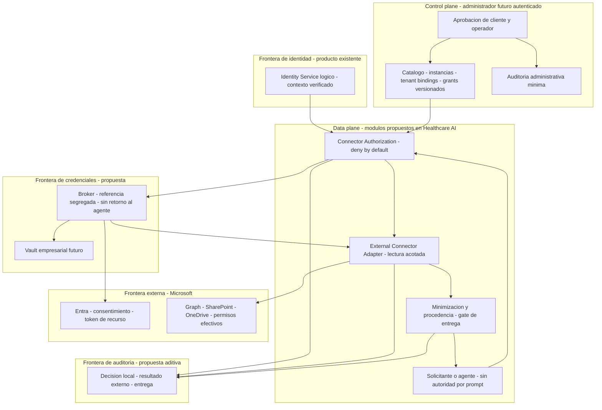
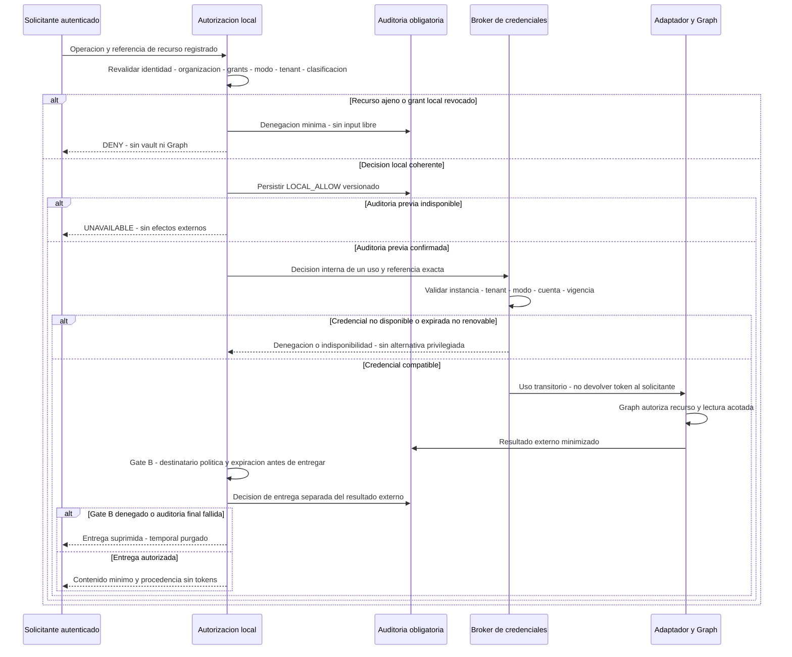
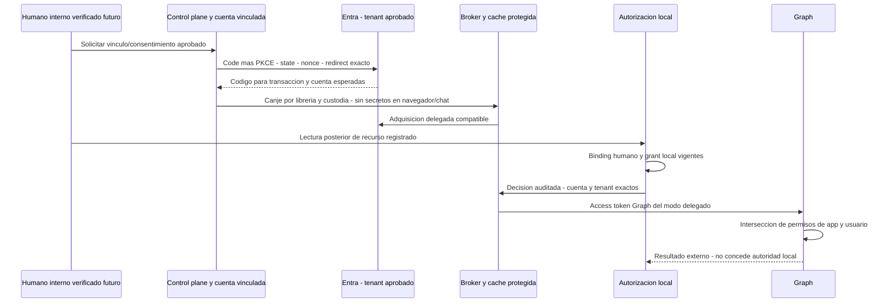
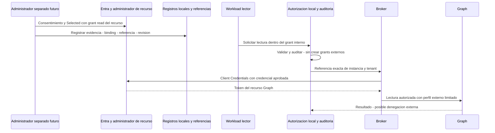

# Enterprise Connector Authorization V1 — arquitectura

TASK 001 exclusivamente documental; **dirección arquitectónica aprobada por el Product Owner, controles pendientes de implementación**. No conector/endpoints/vault/consentimiento implementados. IAM TASK 006 está integrada mediante PR #108; su evidencia de laboratorio no autoriza recursos Microsoft. [ADR-096](../adr/ADR-096-identity-provider-agnostic-v1.md) se preserva; [ADR-097](../adr/ADR-097-enterprise-connector-authorization-boundaries.md) está **Accepted — architectural direction only**. Contratos: [autorización local y auditoría](../contracts/enterprise-connector-authorization-v1.md), [permisos Graph investigados](../contracts/microsoft-graph-connector-permissions-v1.md).

## Inventario: implementado frente a propuesto

| Componente inspeccionado | Estado real / límite |
|---|---|
| `infra/iam-lab/` y validación [IAM final](identity-access-foundation-v1-final-validation.md) | Fixture Keycloak, verificadores independientes y pruebas de laboratorio; no app Entra ni Graph |
| Python `oidc_workload`, `oidc_verifier`, `trusted_identity_registry` | Workloads en ruta técnica, política local SQLite opt-in y revocación; no humanos corporativos ni autorización de conectores |
| Java `lab.healthcare.fhir.iam` | Frontera técnica opt-in, bindings estáticos, auditoría propia; no broker Graph |
| Auditorías OIDC Python/Java y Federation/legacy | Stores/vocabularios distintos, sin auditoría empresarial centralizada; requieren contrato aditivo para nuevos eventos |
| Organizaciones actuales | Identificadores de membresía/política, no mapeo automático a tenants Microsoft o fuentes clínicas |
| Java conectores FHIR/SMART/Mini HIS/LIS | Integración clínica y grants de fuentes existentes; no trasladarlos a autorización empresarial |
| [RAG institucional](../contracts/institutional-knowledge-retrieval-v1.md) / [ADR-090](../adr/ADR-090-institutional-knowledge-rag.md) | Corpus sintético local con embeddings; no SharePoint, ACL empresarial ni indexación multi-organización |
| Agentes empresariales/híbridos y MCP | Modalidades/capacidad planificadas; no runtime genérico ni herramientas implementadas |

No había documento equivalente de Enterprise Connector Authorization ni ADR posterior a 096 al iniciar. Se crean responsabilidades nuevas sin duplicar el diseño IAM ni modificarlo.

## Dirección aceptada: tres autoridades, dos planos

La autorización de una lectura es la intersección de Platform Identity, Connector Authorization y External Resource Authorization. Identity Service en los diagramas es un **rol lógico de los módulos IAM**, no un tercer microservicio. El modelo propone módulos dentro de Healthcare AI para el primer consumidor empresarial; no obliga a que Healthcare Interoperability participe en lecturas no clínicas ni incorpora protocolos HIS/LIS a Python. Java conserva adquisición/normalización clínica; una modalidad híbrida necesitará contratos explícitos y no unirá permisos.

Las flechas no representan APIs nuevas implementadas. Ninguna cruza credenciales hacia AG, prompts, checkpoints o RAG. El acceso de control plane al vault configura referencias y custodia con autorización propia; el agente no registra instancias, consiente ni cambia grants. El worker lector no posee credenciales de administración Graph/consentimiento.

## Frontera de organizaciones y cuentas

Una ConnectorInstance pertenece a una organización interna y liga un TenantConnectorBinding exacto de tenant de recurso, cloud, app/service principal, modo y referencias autorizadas. Cliente comercial, organización SaaS y tenant externo son relaciones, no sinónimos. Un mismo tenant puede atender varias organizaciones con instancias/grants separados. Preferir al inicio un entorno single-tenant de prueba y recursos dedicados; esto es una recomendación pendiente de decisión, no un registro Azure creado.

Credenciales no se seleccionan por email, URL recibida, prompt o claims no validados. Delegated añade un vínculo explícito de principal humano interno con la identidad Microsoft del tenant de recurso. Usuarios B2B, recursos remotos y tenants compartidos requieren una excepción contractual/test-owned separada; se deniegan inicialmente. La existencia de un link o guest no modifica la organización activa ni resuelve un tenant por sí sola.

## A. Lectura autorizada y condiciones de denegación

Caso D (recurso ajeno) y E (revocación local) terminan antes de obtener credencial. Si el contexto expira durante trabajo diferido, se reautentica/reautoriza: no se reutiliza un contexto serializado como permiso actual.

## B. Delegated Access

Este flujo NO existe hoy en Human Review. Exige futura adopción humana/linking/consentimiento con su propio contrato, no email-based linking ni password grant. El usuario puede carecer de ACL aun si el consentimiento y grant local existen. Consent phishing, cuenta equivocada o tenant no aprobado detienen el vínculo. Refresh/reauth son controlados por broker y usuario, no por el LLM. OBO solo es alternativa cuando exista una cadena Entra delegada compatible; no se cambia Keycloak por Entra automáticamente. Los prerrequisitos Microsoft están centralizados en el [perfil Graph](../contracts/microsoft-graph-connector-permissions-v1.md#oauth-obo-y-tokens).

## C. Application Access

Separar consentimiento administrativo, asignación Selected y autorización local; ninguna sustituye las otras. El administrador no es el principal del worker. No instalar permisos amplios en el lector para que se autoconceda Selected. El primer piloto debe probar denegación del recurso hermano y ausencia de privilegios administrativos del worker, no solo una descarga positiva.

## F–H. Revocación externa, credenciales y proveedor

| Caso | Decisión propuesta y evidencia |
|---|---|
| F: consentimiento o ACL externos retirados | Graph 401/403 se registra como resultado externo denegado; suspender o requerir revisión según motivo controlado. Sin fallback/cambio de tenant/scope; no suponer que el pre-check sabía la ACL efectiva |
| G: vault/referencia/certificado/refresh fallido | No llamada de contenido; credencial no disponible o interacción requerida. Mantener localmente suspendido si es necesario; nunca pedir contraseña al usuario/agente |
| H: proveedor caído o throttling | Resultado no disponible, sin contenido parcial presentado como completo; timeout/presupuesto y Retry-After acotados, solo misma operación/perfil reautorizados |
| Cambios durante fetch/paginación | Nueva revisión/expiración detectada invalida entrega o continuación. El contenido no entregable se purga; no prometer deshacer lecturas ya externas ni revocación instantánea mundial |

La autorización local se vuelve a comprobar antes de adquisición, cada continuación/reintento y entrega. No cachear grants positivos indefinidamente. Un cache hit de contenido/embedding no elude la política. Cachés y copias futuras son datos empresariales sujetos a borrado, retención y revocación; fuera de esta TASK no se crea ninguna.

## Transporte y datos no confiables

Construir endpoints exclusivamente desde el perfil de proveedor/cloud y IDs canónicos registrados; el consumidor no elige URLs. Validar resultados, nextLink y redirecciones antes de seguirlos. El caso Graph `/content` puede requerir una política distinta de descarga preautenticada: sin propagación del Authorization original, sin log ni devolución de la URL sensible; si esa política no está aprobada, contenido permanece deshabilitado. No existe conector HTTP genérico para cualquier link compartido.

Definir presupuestos finitos por definición: páginas, ítems, bytes comprimidos/descomprimidos, tiempo, reintentos, MIME y extracción. Cifras concretas se deciden/prueban en el fixture sintético y no se atribuyen a límites Microsoft. Extracción en aislamiento, sin macros/JS, archivos activos, enlaces embebidos, fetches secundarios ni ejecución de instrucciones. Malware, zip bombs, formatos no aprobados y clasificación incierta se rechazan/cuarentenan bajo política explícita futura.

LangGraph ordena solicitudes acotadas, no autoriza ni cambia instancias/grants. La aplicación deriva contexto y destino de salida, no el LLM. Un documento recuperado es datos no confiables: no modifica organización, credenciales, scopes, herramientas ni políticas. Enviar su texto a un proveedor LLM es otro efecto autorizado por clasificación/destino/retención, no consecuencia automática de un permiso de lectura. MCP futuro deberá reautorizar cada tool; su registry no es el TenantConnectorBinding.

## Cuatro gates independientes de uso de datos

El [contrato local](../contracts/enterprise-connector-authorization-v1.md#autorizaciones-independientes-de-uso-de-datos) distingue **A consultar/adquirir**, **B entregar al usuario autorizado**, **C procesar con modelo concreto/destino aprobado** y **D indexar o conservar derivados**. A no implica B/C/D; los efectos aplicables se autorizan separadamente. D permanece **deshabilitado V1**, incluidos embeddings e incorporación persistente de contenido/derivados a checkpoints. La auditoría mínima no es retención de documentos.

Antes de C debe verificarse clasificación, proveedor/modelo/deployment, destino, propósito, minimización y política de uso/retención; sin aprobación no se envía contenido. Antes de B se revalida destinatario/organización/recurso/política, incluso si el resultado proviene de caché. Ninguna respuesta/cita/resultado de una organización puede incluir documentos de otra. La caché transitoria, si fuera aprobada, no se vuelve un índice ni permiso permanente.

Pruebas futuras en TASK 002/005/007: A permitido con C no autorizado produce cero envío; documento hostil no activa herramientas ni modifica permisos; cache hit se reautoriza; documentos de organización B no aparecen en respuestas/citas/resultados de A; read no habilita indexación, sharing ni exfiltración. Son gates verificables pendientes, no controles runtime implementados por esta documentación.

## Integracion LangGraph futura y controlada

La futura **TASK 005 — LangGraph Enterprise Connector Integration** requiere autorización propia y consume una capacidad/herramienta controlada del adaptador, nunca HTTP Graph arbitrario. No existe hoy un framework genérico productivo de agentes empresariales y el endpoint IAM de laboratorio no autentica automáticamente una invocación LangGraph.

Una frontera autenticada y autorizada debe obtener la identidad verificada y construir un execution envelope confiable vinculado a principal, organización, instancia, operación, recurso y propósito, con vigencia y versiones de política. Un PrincipalContext incluido en prompt, tool arguments, checkpoint o entrada de usuario es dato no confiable, no autoridad. Referencias del checkpoint no sustituyen reautorización de operaciones asíncronas, continuaciones, páginas, cache hits o entregas; organización/recurso ajenos se deniegan antes del broker.

Tokens Microsoft y credenciales permanecen en broker/adaptador, fuera de LangGraph, prompts, estados, checkpoints y logs. El contenido se etiqueta `untrusted_enterprise_document`, no cambia permisos ni habilita herramientas/destinos. Aplicar A/B/C/D y auditar separadamente autorización local, acceso externo, entrega y uso por modelo. Pruebas negativas de prompt injection, exfiltración y aislamiento deben acompañar la revisión de compatibilidad con protocolos clínicos, su autoridad determinista y Human Review. No se activa RAG, MCP, índice permanente o agente híbrido automáticamente. El [plan](enterprise-connector-authorization-implementation-plan-v1.md#task-005--langgraph-enterprise-connector-integration) establece aceptación futura, no autorización de ejecución.

## Módulo reutilizable frente a servicio dedicado

| Criterio | Módulo interno reutilizable (recomendado inicialmente) | Servicio dedicado de conectores |
|---|---|---|
| Aislamiento | Interfaces/secret boundary y egress; comparte proceso/OS, no aislamiento fuerte | Puede aislar proceso/red; requiere identidad/autorización de cada hop |
| Seguridad | Menos credenciales/hops; un compromiso del host sigue siendo riesgo | Mayor separación potencial; añade confused deputy, replay y protocolo de propagación |
| Complejidad | Usa las dos unidades existentes; pruebas locales y dependencias acotadas | Nueva API, despliegue, disponibilidad, versionado de decisiones y tenancy |
| Operación | Menos componentes; límites/custodia auditables por producto | Colas, escalado, secrets/SIEM/HA y on-call independientes |
| Costo | Menor costo inicial; extracción compartida debe estar aislada | Mayor costo fijo, útil si volumen/aislamiento lo justifican |
| Evolución | Definiciones/política/adaptadores desacoplados, contrato extraíble | Reutilización entre productos/consumidores si necesidad real demostrada |

Recomendación propuesta: módulos lógicos internos, API de autorización desacoplada del adaptador y broker, primer consumidor empresarial en Healthcare AI sin Java/FHIR obligatorio. No crear un servicio ahora, ni decidir lenguaje/SDK definitivo ni compartir bases/objetos IAM entre procesos. Un servicio futuro requerirá ADR y contrato de autenticación/propagación/replay/correlación/organización propios. La separación lógica no se presenta como sandbox; extracción de documentos y vault necesitan su despliegue seguro antes de acceso real.

## Portabilidad Azure/AWS

Contrato común: capacidad local, identidad de recurso cualificada, grant interno, descriptor de permiso externo tipado, referencia/adquisición y resultado. Graph Selected no es Azure RBAC ni IAM AWS. Azure Blob necesitará su perfil de cuenta/contenedor/data plane/credencial; S3 su cuenta/rol/bucket/key y políticas. No se usa el token de login de plataforma directamente en esos recursos ni se crea un scope universal. Esta es extensibilidad conceptual, no conectores nuevos.

## Decisiones del Product Owner antes de runtime

ADR-097 acepta la separación de autoridades, el enfoque modular inicial y controles/restricciones conceptuales; no certifica Graph ni implementa custodia. Pendientes: ubicación concreta del módulo y responsables; modo/piloto inicial; alcance site/lista/archivo y métodos; quién administra bindings/grants; app single/multitenant; tenant y recursos sintéticos autorizados; vault/broker/certificados; privacidad/clasificación/modelos/destinos; retención y auditoría; descarga/egress; requerimientos de B2B y RAG. Las dudas de soporte externo permanecen pendientes en el perfil Graph. El [plan de siete tareas](enterprise-connector-authorization-implementation-plan-v1.md) añade LangGraph en TASK 005, delegated en TASK 006 y E2E en TASK 007. Ninguna aceptación autoriza tareas posteriores, permisos reales, credenciales o llamadas Graph hoy.
