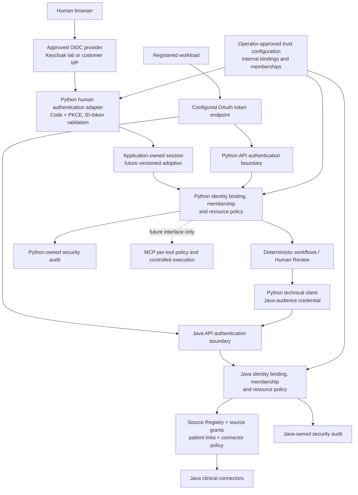

# Identity & Access Foundation v1

## Status and scope

Identity & Access Foundation V1 — TASK 001 records the architecture and design contracts approved by the Product Owner, including the final lifecycle, audience and fixture clarifications. The architectural direction in ADR-096 is accepted; its runtime capabilities remain unimplemented. This task implements no IAM runtime, provider, verifier, UI, endpoint, user database, resource tenancy or migration. Security & Governance V1 TASK 001–007 are integrated and technically closed for their laboratory scope. Their [closure evidence](../ai-governance/security-governance-v1-closure.md) remains bounded: HAPI legacy live compatibility is independently pending, and there is no production-readiness or regulatory claim.

The commercial target is one provider-independent identity boundary usable in SaaS and dedicated customer installations. Keycloak is a laboratory OIDC provider, not a mandatory customer dependency. Entra ID, Auth0, Okta and corporate Keycloak are future onboarding candidates, not implemented integrations. Clinical protocols and agent logic must not import provider-specific roles, realm names or token layouts.

Approved design interfaces: [Principal Context v1](../contracts/identity-principal-context-v1.md) and [OIDC Provider Integration v1](../contracts/oidc-provider-integration-v1.md). Accepted decision record: [ADR-096](../adr/ADR-096-identity-provider-agnostic-v1.md). Existing operational contracts remain authoritative until a later task explicitly implements/adopts these interfaces.

## Existing authentication inventory

The table records inspected source, not inferred production capabilities. Paths below are relative to `services/`.

| Boundary | Real mechanism and implementation | Identity/authorization limit |
|---|---|---|
| Python `/internal/*` handlers | `ai-service/app/service_auth.py` checks exactly one `X-Service-Token`, using SHA-256 and constant-time comparison; `main.py`, `followup_service.py`, `followup_review_http.py`, `clinical_review_context_http.py` and other route services enforce it | Shared configured credential; no distinct workload registration, organization membership or human identity |
| Human Review login | `human_development_auth.py`: explicit development flag, configured and accepted-socket loopback guards, distinct development secret, one configured synthetic `HumanPrincipal` | No user directory, corporate SSO, clinician verification or per-case assignment; a proxy in front of loopback is outside the development network contract |
| Human session | `human_session.py`, `human_session_sqlite.py`: opaque 256-bit token, hash-only storage, absolute eight-hour expiry and revocation | Domain validator and schema accept only `DEVELOPMENT_AUTHENTICATOR_V1`; no OIDC session migration is implemented |
| Human forms and cookies | `human_review_client.py`, `human_development_auth.py`: same-origin checks, expiring purpose-separated HMAC bound to case/session, `HttpOnly`, `SameSite=Strict`, conditional `Secure`; assistance uses a separate one-time handoff | Presentation/session protection is independent of case authorization; the browser never receives the service token |
| Human attribution | `human_attribution.py` and Review repository: server-resolved synthetic principal snapshot, closure/coordination writes in the business transaction | Development-only authenticator allowlist; no backfill or verified clinician identity. Internal service close remains unattributed |
| Python security audit | `security_audit.py`, `security_audit_sqlite.py`: closed event/actor/metadata rules and independent SQLite | Covers development authentication, workflow start/resume HTTP boundaries and Human Review close; not every route or internal graph invocation |
| LangGraph | `followup_service.py` HTTP entry and `langgraph_workflow_orchestration.py` business orchestration/checkpoint | Start/resume endpoint decisions precede graph entry. Internal demo execution and post-close auto-resume do not invent a service actor or endpoint access event |
| Python → Java | `clinical_read_client.py` uses the Model Boundary service credential; `clinical_federation_client.py` uses a separate participant token and `FED-` correlation | Technical hop identity. A human login/session is not forwarded or converted into a participant |
| Java Model Boundary | `modelboundary/web/ModelBoundaryServiceAuthFilter.java` and `ModelBoundaryServiceTokenSettings.java`: exact single-header service credential on the existing GET surface | Shared technical credential, not a human or organization |
| Java Clinical Read / source catalogue | `clinicalread/web/ClinicalReadServiceAuthFilter.java`, `ClinicalReadAuthConfiguration.java`: service-token gate for Clinical Read and `/api/interop/v1/*` | One configured clinical source; default remains `local-hapi`. No new permission or multi-organization resource isolation is inferred |
| Java Federation authentication | `federation/FederationSecurityConfiguration.java`: distinct configured participant tokens, exact single header, matched token supplies server-side `federation.caller` | Participant/system identity, not a reviewer. Authentication denial is audited |
| Java Federation authorization | `interop/SourceRegistry.java`, `FederationProperties.java`, `FederationService.java`: registered organization, caller system, source grants and exchange patient links | Request body cannot choose the effective caller. Organization, caller-system and source denials precede connectors. Partial/source failure is distinct from denied access |
| Java Federation audit | `federation/audit/*`: minimized `clinical_federation_access` before protected work, dedicated SQLite and fail-closed append | Durable local laboratory decisions, not a global immutable ledger or cross-service transaction |
| Java laboratory exchange | Separate `exchange/ExchangeSecurityConfiguration.java` participant filter and exchange organization checks | It uses `getHeader` and trims the presented value; the exact/duplicate-header hardening in Security & Governance TASK 005 did not cover this separate surface. This pending hardening gap needs its own bounded future scope; TASK 001 changes no filter and opens no additional task |
| Outbound FHIR OAuth/SMART | `auth/oauth2/OAuth2TokenClient.java`, `client/FhirAccessTokenProviders.java`, `smart/SmartAuthorizationCoordinator.java`: destination profiles, Client Credentials or SMART code/PKCE, state/session and issued-token handling | Credentials authorize configured external FHIR access. Existing SMART callbacks are not Human Review SSO or an inbound OIDC API verifier |

See [service hardening](../ai-governance/service-security-hardening-v1.md), [Human identity](../contracts/human-identity-v1.md), [Human attribution](../contracts/human-attribution-v1.md) and [Security audit](../contracts/security-audit-v1.md) for the current guarantees. In particular, the present session/attribution schemas and audit actors cannot accept arbitrary new OIDC principals without a versioned change.

## Target trust boundaries and components

The diagram is a target, not the current request routing. These adapters/resolvers are modules inside the existing product units; no central identity microservice or additional deployable product is proposed. Independent installations own separate identity namespaces. A composed deployment must provision a coherent, versioned trust/binding configuration to both units; a matching string in an untrusted request is never that provisioned binding.

Six decisions remain separate:

| Concern | Owner | What it does not establish |
|---|---|---|
| Human authentication | Approved IdP plus local relying-party/session boundary | Clinician verification, assignment or access to a case |
| Service authentication | Receiving API's verifier and registered client binding | Human intent or delegation |
| Organization membership | Application's trusted principal/membership records | Permission on every resource or every external source |
| Resource authorization | Resource owner and deterministic policies | Credential for Azure, Graph, AWS or external FHIR |
| Future tool authorization | MCP registry/policy and execution boundary | Expanded identity permissions from tool output |
| External credentials | Enterprise Connector Authorization, or existing Java destination contracts for current FHIR connectors | Reuse of a product-login token on another service |

Tokens, browser data, documents and future MCP/API content enter from outside the trusted boundary. They cannot rewrite provider registrations, memberships, effective permissions, system instructions or execution limits. Provider administrators can authenticate users but cannot directly change application grants through an unchecked role claim.

## Human and workload flows

Human target flow:

1. An explicitly configured human login mode chooses an approved provider/client; the application stores a single-use browser transaction with state, nonce, verifier, redirect and expected issuer. An organization hint is not authority.
2. The browser authenticates at that provider with code/PKCE. The backend redeems the code only against the configured endpoint, then verifies the ID token and resolves `(issuer, subject)` to a stable internal principal.
3. Revalidate enabled membership, select exactly one active organization and evaluate local session policy. Only after required audit succeeds issue a new opaque application session; no IdP token in the cookie or browser storage. An unmapped principal has no application access.
4. Each protected request resolves the session, refreshes required membership/policy state, checks resource access and retains same-origin, purpose-bound HMAC, optimistic version and deterministic business rules. The local session's expiry/revocation policy is independent of the initial ID token's expiry; reusing the session preserves its original authentication evidence. Sensitive operations can require verified reauthentication before proceeding. Authentication does not select a Review outcome.
5. Logout revokes the local session. Provider SSO logout, back-channel logout, refresh-token handling and immediate cross-service revocation require later explicit contracts. Do not promise them from a local cookie clear.

Workload target flow:

1. A technical client uses its own non-administrative credential and configured OAuth Client Credentials flow, requesting the specific API audience. It does not authenticate through a human password or review cookie.
2. That API validates the access token/profile, maps the external/client binding to a registered workload or federation participant and selects an authorized organization. The request context cannot outlive that access token's effective expiry or a stricter local policy limit. No domain action is allowed for an unbound client.
3. The API evaluates resource policy and required audit before protected work. Python-to-Java uses a distinct Java-audience credential; Java rechecks its own trust, organization and grants. Python's local authorization is not a substitute.
4. Work performed after a Human Review close remains triggered by the committed deterministic decision. Do not label internal auto-resume as a fresh human login or fabricate a service-token request. Later delegated external actions need a separate actor-chain contract.

The [Principal Context design](../contracts/identity-principal-context-v1.md) is immutable and request-local. No whole context or credentials are persisted in LangGraph checkpoints. `effective_permissions` comes from local policy, never a blind copy of provider scopes/groups. Its correlation field does not close the existing global-correlation gap.

## Organizations and deployment modes

An application organization is not an OIDC realm, Microsoft tenant, email domain or clinical-source system. A trust configuration can associate one provider with several organizations, while enabled memberships and client bindings constrain each principal. A user with two memberships selects one; its permissions are not the union of both. Separate issuers with the same `sub` are separate external identities unless an explicit linking procedure approves a shared internal principal.

| Mode | Shared architecture | Additional isolation requirement |
|---|---|---|
| SaaS for several customers | Same Java/Python modules and contracts, multiple approved provider and organization bindings | Organization-bound case/workflow/connection storage, queries, caches, queues and every effect; explicit cross-organization source grants; tenant-specific secrets and administration |
| Dedicated customer deployment | Same code with a fixed allowed organization set and its approved corporate provider | Still verify membership, API audience and resource policy; deployment location alone does not grant access |

Existing Review/session/workflow stores and general service-token routes are not a product multi-tenancy implementation. Enabling multiple OIDC providers must not expose those stores to multiple organizations before resource ownership, scoped queries and denial tests are implemented and approved. Provider trust for multiple organizations can be designed/tested synthetically without declaring SaaS isolation complete.

Clinical Federation legitimately reads different source organizations under existing explicit grants and patient correspondence; it must not be broken by treating every source as the caller's own organization. Conversely, that clinical exchange grant does not grant access to another organization's Review queue or enterprise tools.

## Incremental adoption and endpoint policies

No endpoint changes authentication in TASK 001 or merely because Keycloak starts in TASK 002. Each later migration specifies its method, actor type, audience, organization requirement, resource policy, denial behavior, audit event and rollback plan. There is one effective authentication method per endpoint policy, never an ordered "try OIDC then shared secret" fallback. Conflicting presented credential methods must be rejected by the future migrated boundary; cookies automatically sent by a browser do not become service credentials.

| Existing surface | Mode retained now | Requirement before later OIDC adoption |
|---|---|---|
| `/health`, existing public static assets | Current public, non-sensitive behavior | No token-induced access to new data |
| Python `/internal/*` | Exact `X-Service-Token`; human cookie ignored | Registered workload, Python API audience, explicit route permissions and organization/resource policy |
| Python review/demo human routes | Development authenticator/session and current HMAC | New session/authenticator contract and additive migrations, internal human binding, resource authorization, preserved CSRF/form controls |
| Java Model Boundary / Clinical Read / catalogue | Existing exact service-token policy | Java API audience, trusted client/organization policy; preserve current Clinical Read envelope and default source |
| Java Clinical Federation | Existing participant-token policy | Explicit issuer/client-to-participant binding; verified registry organization/caller/source grants and mandatory access audit still execute |
| Java laboratory exchange | Existing separate participant policy | Separate inventory/hardening and adoption decision; no implicit inheritance from Federation changes |
| Java outbound SMART/OAuth | Existing destination-specific flow | External connector credential contract; never substitute product IdP tokens |

Legacy authentication can remain on unconverted endpoints during migration. Changing one route must neither open another route nor make an invalid OIDC token acceptable through legacy fallback. Reverting to a previously approved mode is an operator-controlled configuration change with explicit session/credential invalidation, not an automatic response to an IdP outage.

Audit v1 has closed actor types and event metadata. Future OIDC login/workload actors require an approved additive event contract and tests; do not cast them as `development_principal` or `service_client` just to fit old validators. Keep Python/Java stores separate, minimize data and fail closed when the applicable mandatory event cannot be persisted. Security audit and business attribution remain distinct transactions/records with the documented inconsistency windows.

## TASK 002 proposal: isolated Keycloak laboratory foundation

This is a proposed next task, not runtime authorization in TASK 001. TASK 002 should establish the provider fixture and reproducible evidence only; product OIDC verifiers, Human Review migration and enterprise RBAC belong to later approved slices.

1. Choose a maintained Keycloak release at implementation time, verify official release/security notes, and commit an exact image tag plus immutable digest. Never use `latest`; the version/digest is an explicit TASK 002 acceptance item, not a guessed permanent value in this design.
2. Add an opt-in support-stack definition in a new, clearly owned laboratory path/project, independent of the existing HAPI compose stack. Publish only `127.0.0.1:${IAM_LAB_HTTP_PORT}:8080`; proposed host default `18090`, configurable and checked for conflicts without stopping any owner process. Pin memory/storage policy and resource ownership labels. `start-dev` and any HTTP exception are local-development only.
3. Use a dedicated realm such as `healthcare-iam-lab`. Start with one realm containing two synthetic application organizations and explicit memberships to prove that realms do not equal organizations. Publish one exact issuer URL used by the browser, host-side Python and host-side Java. Verify the same issuer in discovery and signed tokens and the approved JWKS URI. Do not rewrite JWT issuer strings, disable validation or accept alternate issuer aliases to work around networking differences.
4. Define separate clients: `healthcare-review-web` for interactive code/PKCE; `healthcare-ai-api` and `healthcare-interop-api` as distinct resource audiences; separate workload clients for the lab caller and AI-to-Java calls. Explicitly configure audience mappers/client scopes and issuance policy, then validate actual issued `aud` values: two client registrations do not guarantee resource separation. Disable implicit/password grants, disable service accounts for human/API-only clients, and constrain each workload to its intended API audience. Keep browser client secrets server-side when confidential.
5. Use only synthetic test users/organization mappings. Provision administrative bootstrap and confidential-client secrets through ignored per-run environment/secret files with approved permissions. No real values in realm exports, command output or Git. Agents use workload credentials, never bootstrap admin credentials. No ACL change is implicitly authorized by this plan.
6. Export sanitized deterministic realm/client configuration and document fresh-import behavior. Initialization must target only the new fixture; do not overwrite an existing realm/server. Storage is test-owned; a disposable local development store is sufficient, with no product user database or shared Review database.
7. Add bounded opt-in fixture checks for discovery issuer, configured JWKS, effective audience separation and client-credentials tokens using a test-only validation harness. Document a secure Keycloak-specific access-token profile if the chosen version does not emit compatible RFC 9068 tokens; do not force that format or relax signature, token-purpose or audience validation. Run the mandatory positive/negative cases below solely in the fixture harness. Test interactive code/PKCE only with an explicitly invoked browser/test callback harness, not a new product UI or default integration test. Never use password grant as a shortcut. Do not route those tokens into current product endpoints or claim to have tested product OIDC verifiers.
8. Verify cleanup ownership before removing resources; stop/remove only the fixture resources created by that run. Do not start, stop, seed or inspect clinical resources in `local-hapi`. Existing Mini HIS/LIS databases and all operator containers remain outside the fixture.

Keycloak container/development and import behavior is documented by [the official container guide](https://www.keycloak.org/server/containers). Application image pinning, realm layout and port choices above are our proposed laboratory policy, not production recommendations copied from a quickstart.

### TASK 002 acceptance matrix

| Check | Required evidence |
|---|---|
| Scope | Approved runtime task, exact image/tag/digest, named own resources and conflict-free loopback port |
| Default safety | Existing builds/tests do not start Keycloak or contact its endpoints; explicit opt-in required |
| Reproducibility | Fresh fixture import yields the documented synthetic realm/clients without altering an existing server |
| Discovery and keys | Exact same published issuer for browser and host-side Java/Python, consistent discovery/token issuer and preapproved JWKS; valid signature accepted, wrong issuer/unapproved key source rejected |
| Clients and audiences | Explicit mapper/scope policy and actual issued audiences verified; AI token accepted by its profile and rejected by the Interoperability profile; Interoperability token accepted by its profile and rejected by the AI profile |
| Token purpose/profile | ID token rejected as API access token; documented Keycloak-specific profile when needed, preserving signature/purpose/audience checks without assuming RFC 9068 emission |
| Human flow | Code/PKCE with state/nonce and exact redirect demonstrated in an explicit fixture harness, or clearly reported pending; password/implicit disabled |
| Workload flow | Dedicated non-admin credential; token client identity matches registered synthetic workload and requested audience; unknown workload rejected even when its token signature is valid |
| Organization model | Two synthetic memberships in one issuer remain separate; unknown membership/forged organization rejected in deterministic contract fixtures |
| Failure behavior | Missing secrets, wrong issuer/audience, unknown key and discovery failure never trigger permissive fallback |
| Integrity | No secret-bearing export/output, no HAPI/other-operator resource mutation, deterministic product regression unchanged |
| Cleanup | Run-owned containers/storage accounted for, with no deletion of resources merely sharing a prefix |
| Handoff | Actual executed/pending fixture-only evidence and known lab limitations documented; tests do not validate product OIDC verifiers, and make no product OIDC or SaaS readiness claim |

## Threat model and later tests

These are required future tests/mitigations, not tests executed by TASK 001.

| Threat | Mitigation and expected negative evidence |
|---|---|
| Unknown provider token | Finite trusted-provider lookup; reject without dynamic discovery or domain calls |
| Valid token for another API | API-specific audience and token-purpose profile; reject an AI token at Java and an ID token at either API |
| Expired, premature or manipulated token | Signature/temporal validation and bounded skew; no policy, graph or connector side effect |
| Unexpected algorithm / algorithm confusion | Explicit asymmetric allowlist and key-type checks; reject `none` and HS substitution |
| Unknown JWKS key / rotation DoS | Issuer-scoped bounded refresh, throttle and hard TTL; reject unresolved keys, no attacker-selected key endpoint |
| Organization confusion / forged tenant | Enabled membership plus client and provider organization binding; no first-membership selection or cross-org permission union |
| Subject collision between issuers | Exact issuer+subject binding; same subject from another issuer resolves independently |
| Microsoft tenant spoof | Explicit permitted tenant/issuer and approved signed profile; `/common` is not automatic trust |
| Confused deputy | Specific resource audience and connector/tool policies; no reuse of product login token against Azure, Graph, AWS or external FHIR |
| Service credential reused as reviewer | Principal-type checks, credential purpose separation and endpoint policy; reject cookie/service substitution |
| Forged or excessive roles/groups/scopes | Only validated, configured constraints on existing local grants; arbitrary role strings never create permissions |
| External text/tool output changes identity | Request-local context built only by trusted code; ignore/reject spoofed context headers/fields and injection instructions |
| Callback mix-up, code replay, login CSRF | Browser-bound state/nonce/PKCE, exact redirects and expected issuer; single use and expiry |
| Stale session/membership after revocation | Recheck policy with bounded cache lifetime, explicit session invalidation; no claim of instant global revocation |
| Provider/JWKS/audit outage | Stop the protected operation when its required evidence expires/unavailable; never downgrade to anonymous or legacy access |
| Old attribution/audit schema rejects OIDC | Approve new contracts/migrations first; no editing old migrations or mislabeling actors |

## Enterprise Connectors and MCP

Enterprise Connector Authorization owns new per-organization application/delegated external credentials, consent, Azure Entra resource tokens and Azure RBAC, AWS IAM/STS, resource permissions, revocation and connection isolation. This includes permissions for Azure Blob, SharePoint and Microsoft Graph. Existing Java FHIR OAuth/SMART remains under its current destination contracts. A Keycloak/product OIDC login token proves product authentication only; it is never used directly as an Azure Storage, SharePoint, Microsoft Graph, AWS or external FHIR credential. Token exchange/on-behalf-of is not implemented by naming it.

MCP Integration Foundation will own tool registration, per-tool grants, bounded execution, credential segregation, output validation, invocation audit and Human Review for sensitive actions. It may consume an already verified internal identity under an explicit contract, but tool responses cannot elevate it. This task creates no MCP server/client or enterprise connector.

Clinical agents continue to acquire authorized normalized clinical context through the Java contracts used by their operational flows. Planned enterprise agents can use nonclinical sources without Java/FHIR; hybrid agents combine sources only under explicit contracts and permissions, never a union of both modes' privileges. Identity modules must preserve those independent product/modal boundaries.

## Open decisions and exit criteria for TASK 001

The Product Owner has approved the architecture, design contracts and ADR-096 direction with the final lifecycle/audience clarifications. TASK 002 runtime scope still needs its own authorization. The exact supported Keycloak image/digest, numeric lab policy, operational secret delivery, callback port, secure provider access-token profile, effective audience mappers/scopes, internal binding administration, membership revocation and later resource-tenancy storage remain explicit implementation/deployment decisions. None requires inventing a new runtime in TASK 001.

TASK 001's documentary closure requires consistent source inventory, provider-neutral identity/lifecycle rules, per-route migration constraints, multi-organization denial rules, threat tests and TASK 002 acceptance, all linked. Documentation checks must show only the seven authorized Markdown paths, valid JSON/YAML examples and relative paths, no secrets and preserved Git/stash/foreign files. Acceptance of this design is not runtime implementation: production OIDC, end-to-end correlation, enterprise IAM, external execution, regulatory compliance and live HAPI compatibility remain unclaimed.
