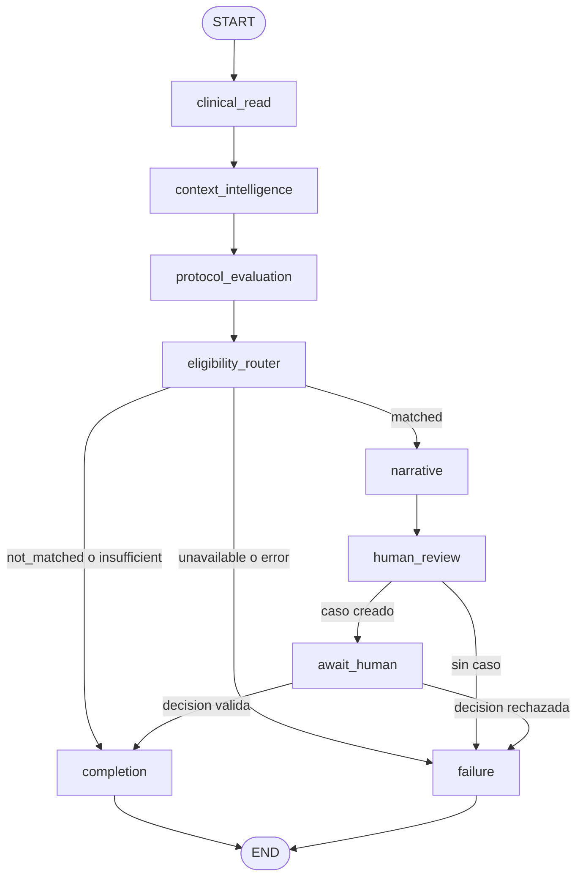

# Orquestación de workflows con LangGraph v1

Mini HIS v2 → Java Clinical Read → Python `StateGraph` → protocolo determinista → Gemini solo para la narrativa → Human Review.

El grafo vive en `services/ai-service/app/langgraph_workflow_orchestration.py`. Los endpoints entran por `followup_service.py` para que `main.py` no dependa del nombre de LangGraph. La decisión humana sigue guardada solo en Human Review.

## Grafo real

`await_human` llama a `interrupt`. La ejecución queda en `waiting_human` hasta `Command(resume=...)`.

## Nodos

| Nodo | Función | Efecto |
| --- | --- | --- |
| `clinical_read` | `read_patient` | Paciente por Java. Si falla, `acquisition_unavailable`. |
| `context_intelligence` | `build_context` | Contexto longitudinal reducido, sin cantidades. |
| `protocol_evaluation` | `evaluate` | `evaluate_post_consultation_review` o `evaluate_missed_follow_up`. |
| `eligibility_router` | `route_protocol` | `matched`, `not_matched`, `insufficient` o `failure`. |
| `narrative` | `prepare_narrative` | Gemini o narrativa ya guardada. No decide elegibilidad. |
| `human_review` | `ensure_review` | Crea o reutiliza el caso y guarda la narrativa una sola vez. |
| `await_human` | `interrupt` | Suspende el grafo. |
| `completion` | registro | `completed`. No vuelve a cerrar la revisión. |
| `failure` | registro | `failed`. Se puede reintentar. |

El identificador `wf-` más 32 hexadecimales sale de `workflow_id_for(case_id, workflow_type)`. Una segunda petición con el mismo caso y tipo devuelve el workflow existente.

## Estado y checkpoint

El estado compartido es `WorkflowState`. Guarda referencias, códigos, el paso actual y el identificador de Human Review. No guarda el texto de la narrativa ni valores clínicos.

`SqliteCheckpointSaver` extiende el saver en memoria de LangGraph 1.2.12 y vuelca los canales a `agent-workflow.sqlite3`, al lado de la base de revisión y separado de Mini HIS. La tabla `workflow_index` responde las consultas. Un GET no llama a `invoke`.

Para reanudar hace falta un checkpointer. `interrupt` relanza el nodo desde el inicio, así que el caso se crea en `human_review`, antes de la pausa. `ensure_for_protocol` reutiliza el mismo caso si el nodo se repite.

## Human Review y Gemini

Cerrar un caso por la página llama a `resume_after_human_decision` solo después de un cierre exitoso. Si no hay un workflow esperando ese caso, el cierre sigue igual. La reanudación compara la decisión ya guardada, el caso y el estado `waiting_human`. Ver la página no reanuda nada.

Gemini entra por `configured_provider` y `generate_operational_narrative` en el seguimiento no realizado, y por `_post_consultation_narrative` en el resultado posterior a la consulta. Si el proveedor falla, el caso queda abierto y no se inventa texto. `record_narrative` no sustituye una narrativa existente.

## Endpoints

Autenticación `X-Service-Token`, igual que el resto de la API interna. El agente tiene que estar habilitado.

- `POST /internal/workflows` con `caseId` y `workflowType` (`post_consultation` o `missed_follow_up`)
- `GET /internal/workflows/{workflowId}`
- `GET /internal/workflows/{workflowId}/steps`
- `GET /internal/workflows/{workflowId}/evidence`
- `GET /internal/workflows/{workflowId}/errors`
- `POST /internal/workflows/{workflowId}/resume` con `reviewCaseId` y `decision`

`POST /internal/agent/follow-up` y `POST /internal/agent/missed-follow-up` no cambian. 401 sin token, 422 si el caso o el tipo no sirven, 403 si la decisión no coincide, 409 si el workflow no está suspendido, 404 si no existe.

## Ejemplos

Con revisión: `SYN-FOLLOWUP-022` y `post_consultation`. La evaluación determinista respondió `matched` para `POST_CONSULTATION_RESULT_REVIEW_V1`. El grafo creó el caso de Human Review, guardó una narrativa simulada y se suspendió en `await_human` con `interrupt`. El estado quedó en `waiting_human`. Esa narrativa no llamó a Gemini.

El workflow fue `wf-b06856b0439209156320e0d3e5f8d396` y el caso `ebe5baa7-a14c-448f-9b32-c032c857eae9`. Se detuvo Python y se volvió a levantar con el mismo `agent-workflow.sqlite3`. Después del reinicio seguían el mismo `workflowId`, el mismo `reviewCaseId`, el estado `waiting_human` y la revisión abierta.

La decisión humana fue `review_completed_no_operational_action`. La reanudación ejecutó `await_human` y `completion`. El workflow terminó en `completed`, la revisión quedó cerrada en versión 2 y no hubo `errorCode`.

Sin revisión: `SYN-FOLLOWUP-024` con cita futura confirmada. El protocolo real responde `not_matched` / `upcoming_confirmed_appointment`. No hay caso ni llamada a Gemini. Estado `completed`.

La recuperación reutiliza el mismo archivo SQLite. El laboratorio admite un único proceso escritor. Otro `SqliteCheckpointSaver` de ese proceso, como en `test_lg08_checkpoint_survives_a_new_saver`, también ve el interrupt. No se ha validado un checkpoint corrupto ni la escritura concurrente de varios procesos.

## Limitaciones

El checkpoint usa pickle del propio proceso y guarda todos los hilos en una sola fila, `checkpoint_state.id = 1` (LG-H1). No es un formato clínico ni un lugar para secretos. Un archivo alterado puede ejecutarse al cargarse. Los candados `gate` y `flush_lock` viven dentro del proceso: dos procesos sobre el mismo archivo pueden pisarse (LG-H2). No hay Redis ni Kafka.

`invoke` vuelca el checkpoint antes de escribir `workflow_index`. Si el proceso muere en ese intervalo, un GET responde 404 hasta que un POST del mismo caso reconstruye el índice (LG-H4).

Un workflow representa el primer recurso que coincide en el seguimiento no realizado; el endpoint anterior puede seguir creando un caso por cada cita. Si el proceso muere después de guardar la revisión y antes de terminar el nodo, el reintento reutiliza el caso. Si Gemini aún no guardó texto, puede generarlo otra vez. El cierre por la página no reintenta una reanudación que falló (LG-H3). El endpoint `resume` sí puede hacerlo cuando el caso ya está cerrado y el workflow sigue en `waiting_human`.

## LangGraph explicado para principiantes

1. **Qué es LangGraph.** Es la librería que ejecuta un grafo de funciones con estado. Aquí se usa la versión 1.2.12. El archivo de estudio es `langgraph_workflow_orchestration.py`.
2. **Por qué lo utilizamos.** El seguimiento tiene pasos que deben ocurrir en orden, una pausa para la persona revisora y una recuperación después de reiniciar Python. Un solo endpoint no recuerda en qué paso se quedó.
3. **Qué es StateGraph.** Es la clase que arma el grafo. `compile_workflow` crea `StateGraph(WorkflowState)`, agrega nodos y lo compila con `compile(checkpointer=saver)`.
4. **Qué es un nodo.** Es una función que recibe el estado y devuelve los campos que cambian. `clinical_read` y `protocol_evaluation` son nodos. El protocolo no está dentro del modelo de lenguaje.
5. **Qué es el estado compartido.** `WorkflowState` es el diccionario que todos los nodos ven. `steps` usa `operator.add` para acumular los nombres de los nodos ya ejecutados.
6. **Qué es una transición condicional.** `eligibility_router` escribe `route`. `add_conditional_edges` elige `narrative`, `completion` o `failure`. Esa elección sale del resultado del protocolo, no de Gemini.
7. **Qué es un checkpoint.** Es la foto del estado. `SqliteCheckpointSaver.put` la guarda en SQLite. Por eso `test_lg08_checkpoint_survives_a_new_saver` puede abrir otro saver y seguir viendo el workflow.
8. **Qué es interrupt/resume.** Dentro de `await_human`, `interrupt(...)` pausa el grafo. `resume_workflow` continúa con `Command(resume=decision)` solo si Human Review ya guardó esa decisión para ese caso.
9. **Cómo se recupera una ejecución.** El identificador del hilo es el `workflow_id`. Al abrir el mismo SQLite, `get_state` muestra si hay un interrupt. `start_workflow` no vuelve a ejecutar un workflow que ya está en espera o completado.
10. **Diferencia entre LangGraph y Gemini.** LangGraph decide qué función corre ahora. Gemini, cuando se llama, solo redacta la propuesta a partir de referencias ya verificadas. No marca `matched`, no diagnostica, no prescribe, no contacta al paciente y no cierra la revisión.

Para leer el código en este orden: `compile_workflow`, `start_workflow`, `SqliteCheckpointSaver`, `await_human`, `resume_workflow`, luego `run_agent_workflow_http` y `_workflow_section`.
